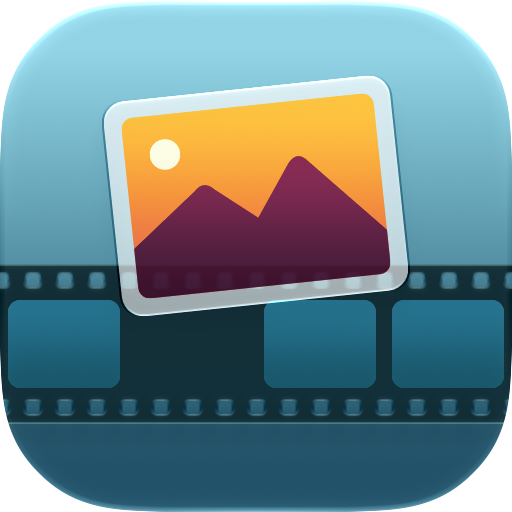
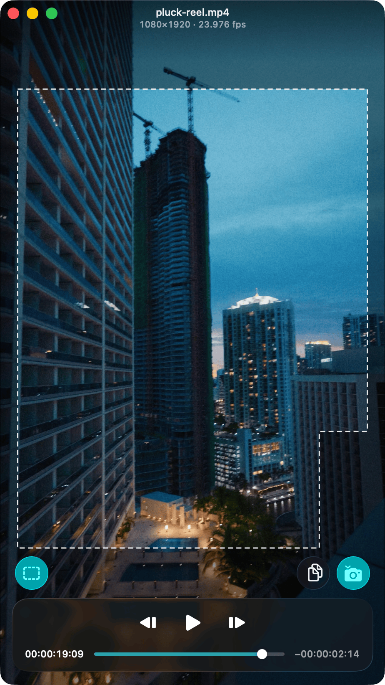

<p align="center">
  
</p>

<h1 align="center">Pluck</h1>

<p align="center">
  Find the exact frame in any video and save it as an image.<br>
  A tiny, native macOS app with Liquid Glass controls.
</p>

<p align="center">
  
</p>

## Features

- **Frame-accurate stepping.** Move one source frame at a time with the arrow keys, comma and period, or K+J / K+L.
- **Save or copy.** Press <kbd>⌘S</kbd> to save the current frame, or <kbd>⌘C</kbd> to copy it to the clipboard. Exports PNG, JPEG, HEIC, or TIFF.
- **Hover to preview.** Scrub the timeline and see the frame under your pointer before you commit.
- **Safe zone guides for 9:16 video.** Overlay the Instagram Reels or Meta ads safe areas, and optionally burn them into saved and copied frames. The button only appears on 9:16 videos.
- **Minimal by design.** The title bar and controls fade away when you stop moving, and the window matches your video's aspect ratio.
- **One window per video.** Every video gets its own window and playback state.
- **Timecode your way.** Click the time to switch between timecode, frame number, and minutes and seconds.
- **Open anywhere.** Drop a video on the window or the app icon, use Open With, or press <kbd>⌘O</kbd>.

## Install

Pluck requires **macOS 26 or later**. Grab the latest build from [Releases](https://github.com/dmccullum/Pluck/releases), or build it yourself below.

## Build from source

Double-click `build.command` to build a Release copy into `Build/Pluck.app` and open it.

Or open `Pluck.xcodeproj` in Xcode and run the `Pluck` scheme, or from Terminal:

```sh
xcodebuild -project Pluck.xcodeproj -scheme Pluck -configuration Release build
```

Pluck uses only Apple frameworks: SwiftUI, AppKit, AVFoundation, and UniformTypeIdentifiers.

## Keyboard shortcuts

| Action | Shortcut |
| --- | --- |
| Open video | <kbd>⌘O</kbd> |
| Play / pause | <kbd>Space</kbd> |
| Shuttle backward (repeat for 2×, 4×, 8×) | <kbd>J</kbd> |
| Pause | <kbd>K</kbd> |
| Shuttle forward (repeat for 2×, 4×, 8×) | <kbd>L</kbd> |
| Previous frame | <kbd>←</kbd>, <kbd>,</kbd>, or hold <kbd>K</kbd> and tap <kbd>J</kbd> |
| Next frame | <kbd>→</kbd>, <kbd>.</kbd>, or hold <kbd>K</kbd> and tap <kbd>L</kbd> |
| Jump back / forward 5 seconds | <kbd>⇧←</kbd> / <kbd>⇧→</kbd> |
| Go to start / end | <kbd>Home</kbd> / <kbd>End</kbd> |
| Save frame | <kbd>⌘S</kbd> |
| Copy frame | <kbd>⌘C</kbd> |
| Settings | <kbd>⌘,</kbd> |

Command-click the safe zone button to turn the guide on or off.

## License

[GPL-3.0](LICENSE)
